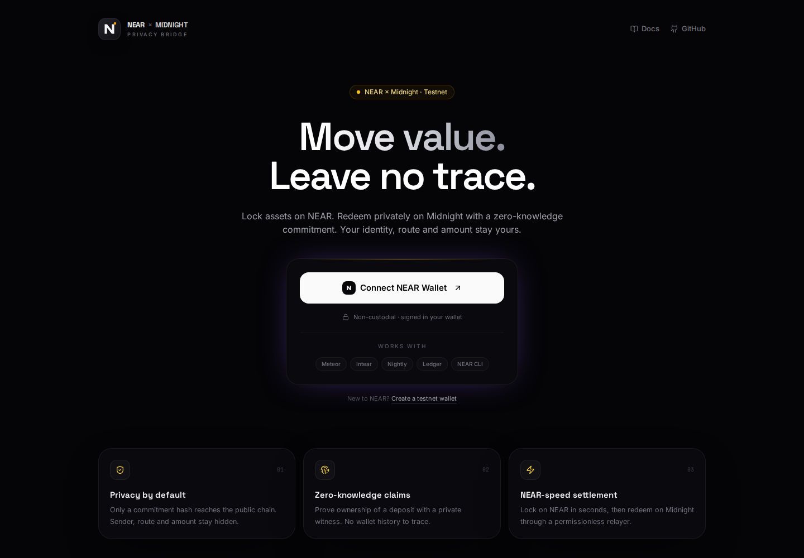
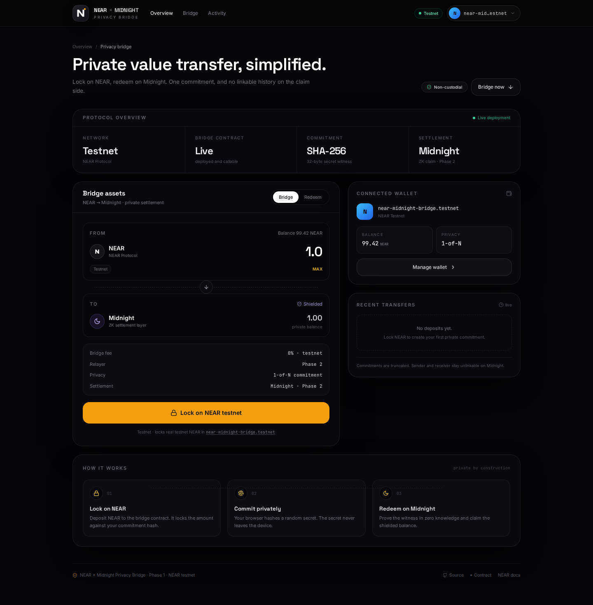

# NEAR × Midnight Privacy Bridge

**Private cross-chain settlement between NEAR and Midnight, powered by zero-knowledge commitments.**

> Built for NEAR HACKATHON 2026 · Tracks: `privacy`, `defi`, `realworld`

[Live demo](https://aryann-4.github.io/NEAR-privacy-bridge/) · [Repository](https://github.com/Aryann-4/NEAR-privacy-bridge) · [NEAR testnet contract](https://explorer.testnet.near.org/accounts/near-midnight-bridge.testnet)



---

## Status: Phase 1 live on NEAR testnet · Phase 2 live on Midnight Preprod

- Real NEAR testnet wallet login, session restore, and live balance.
- `near-midnight-bridge.testnet` deployed with the `near-sdk 5` bridge contract.
- **Lock on NEAR testnet** generates the commitment locally and submits a real `deposit` transaction. The UI shows the transaction hash and an explorer link.
- Five Rust unit tests cover deposits, duplicate commitments, attached-deposit checks, secret verification, and claims.
- The Compact bridge contract is deployed on **Midnight Preprod**. A relayer verifies the NEAR lock, registers a domain-separated Midnight commitment, escrows tNIGHT, and the user claims it with a zero-knowledge proof. See [`midnight-contract/README.md`](midnight-contract/README.md) for the full CLI flow.

## The problem

Traditional bridges publish a complete trail: who moved what, to which chain, and when. That is unacceptable for payroll, business payments, private trading, or simply holding assets without being profiled.

This project breaks the link at the settlement layer. A user locks assets on NEAR against a **commitment hash** — `SHA-256(secret)`. Only the hash is published. On Midnight, the user proves knowledge of the secret in zero knowledge and claims tNIGHT. Observers can verify that a valid claim happened, but cannot link it back to the depositor.

## How it works

```text
     lock(amount, commitmentNear)          register(commitmentMid, amount)
NEAR ─────────────────────────────▶ ▼ ◀───────────────────────────────── relayer
                                    │
                                    │        claim(secret, commitmentMid, recipient)
                                    └──────────────────────────────────▶ Midnight
                                    publishes: commitmentMid, nullifier, recipient

commitmentNear = SHA-256(secret)
commitmentMid  = H("near-midnight:commitment:v1", secret)
```

1. **Lock on NEAR** — the bridge contract stores the amount against `SHA-256(secret)`. The deposit is a normal public NEAR transaction; the privacy boundary is the Midnight claim.
2. **Keep the witness private** — the browser generates a random 32-byte secret and hashes it locally. The secret never leaves the device.
3. **Relayer verification** — the relayer reads the NEAR lock, then registers a *different* commitment on Midnight, derived from the same secret with a Midnight-specific hash domain. It escrows the matching tNIGHT in the contract.
4. **Redeem on Midnight** — the user submits a ZK proof of knowledge of the secret. The proof publishes only the Midnight commitment, a nullifier, and the recipient. A second claim of the same commitment is rejected.

The frontend implements the commitment lifecycle end to end: generation, real testnet lock, downloadable claim file, and local witness verification. The Midnight claim runs through the CLI in `midnight-contract/` so the proof server stays local and the secret never reaches a browser API.

## Demo



**Demo video**: [Google Drive](https://drive.google.com/file/d/198iSlflwhJ8nxYdzQO4U17duaNB8NqVb/view?usp=sharing)

**What works today**

- Real NEAR testnet login through [`@hot-labs/near-connect`](https://github.com/hot-dao/near-selector), with session restore and disconnect.
- Live account balance fetched from NEAR RPC and refreshed after a deposit.
- Real on-chain `deposit` call with the exact attached amount, transaction hash, and explorer link.
- Client-side SHA-256 commitment generation, copy/download, and local witness verification.
- **Midnight Preprod claim**: a relayer verifies the NEAR lock, registers a domain-separated commitment, and the CLI generates a real ZK proof and claims escrowed tNIGHT.
- The Redeem tab verifies the witness locally and exports a claim file for the Midnight CLI.
- Persistent recent-activity list backed by real deposits (empty state until the first lock).
- Responsive dark UI with animated background, accessibility-minded focus states, and a NEAR-native aesthetic.

**Hardening / not yet live**

- The relayer is a single trusted operator. A decentralized relayer set and Merkle-membership claims are the next step.
- The UI intentionally does **not** call the NEAR contract's `withdraw` method: that test-only path accepts the secret as a public argument, which would leak the witness. The Midnight claim verifies it without revealing it.
- No mainnet deployment. Mainnet requires audits, real NEAR for gas/storage, and Blockfrost/DUST for Midnight.

## Tech stack

| Layer | Technology |
| --- | --- |
| Frontend | React 18, Vite 5, Tailwind CSS, TypeScript |
| Wallet | NEAR Connect (`@hot-labs/near-connect`), `near-api-js` RPC |
| NEAR contract | Rust + `near-sdk 5` |
| Midnight contract | Compact `0.23` / compiler `0.31.1` |
| Midnight client | Midnight.js `4.1.1`, wallet-sdk `1.2.0`, local proof server `8.1.0` |
| Privacy primitive | Domain-separated commitments + nullifiers |
| Hosting | GitHub Pages (public demo), Vercel-compatible |

## Repository layout

```text
frontend/                     React app (login, bridge, wallet, activity)
  src/WalletContext.tsx       NEAR Connect provider, session + balance
  src/lib/near-contract.ts    Contract ID, yocto conversion, deposit call
  src/lib/commitment.ts       SHA-256 commitment generation + verification
  src/components/             Landing, Dashboard, BridgeCard, AccountModal
near-contract/                near-sdk 5 lock/unlock contract + unit tests
midnight-contract/            Compact bridge contract, Preprod deploy/claim CLI
  contract/src/bridge.compact register + claim circuits
  src/deploy.ts               Preprod deployment (DUST-aware retries)
  src/register.ts             Relayer verification + tNIGHT escrow
  src/claim.ts                ZK claim CLI
  src/status.ts               Public ledger reader
  src/demo.ts                 End-to-end register → claim demo
.github/workflows/            CI and GitHub Pages deployment
docs/                         Screenshots used in this README
```

## Run locally

Requirements: Node.js 20+ and a NEAR testnet account (for login).

```bash
git clone https://github.com/Aryann-4/NEAR-privacy-bridge.git
cd NEAR-privacy-bridge/frontend
cp .env.example .env
npm install
npm run dev
```

Open <http://localhost:5173>. Click **Connect NEAR Wallet** and choose a wallet from the NEAR Connect modal. No private keys are handled by the app.

The frontend reads `VITE_CONTRACT_ID` (defaults to `near-midnight-bridge.testnet`). Production build:

```bash
npm run build
npm run preview
```

## Contracts

### NEAR — deployed on testnet

| | |
| --- | --- |
| Account | [`near-midnight-bridge.testnet`](https://explorer.testnet.near.org/accounts/near-midnight-bridge.testnet) |
| SDK | `near-sdk 5.30.1` |
| Wasm size | 125.4 KB |
| Unit tests | 5 passing |

**Methods**

- `deposit(amount: U128, commitment: [u8; 32])` — payable; requires the attached deposit to equal `amount`, rejects the zero hash and duplicate commitments, stores the deposit, and emits a `DepositEvent`.
- `get_deposit` / `view_deposit` — return the stored deposit (amount, sender, network, claimed flag).
- `get_user_deposits` / `view_user_deposits` — total currently locked per account.
- `get_deposit_count` — number of deposits ever created.
- `withdraw(commitment, secret)` — test-only direct witness check; marks the commitment claimed and emits an `UnlockEvent`. Not used by the UI because it reveals the secret; the private claim path is Midnight's ZK circuit.

**Build and test**

```bash
cd near-contract
cargo test
cargo near build non-reproducible-wasm
```

**Deploy**

```bash
near create-account near-midnight-bridge.testnet --use-faucet
near deploy near-midnight-bridge.testnet \
  target/near/near_privacy_bridge.wasm \
  --init-function new --init-args '{}'
```

A testnet smoke test locked 1 NEAR against commitment
`110b9623d4c528c8b7cb33a02d9ec209edf38e733417d824846a95df6018bdc6`
([deposit transaction](https://explorer.testnet.near.org/transactions/75Jr4qiPSixvHaSgfYZQRAke8LQ1rVcNY75dHz4uTFLm)) and then verified and claimed it through `withdraw`.

### Midnight — Preprod

| | |
| --- | --- |
| Contract | `20371c7d819fd6c39ac18ad358b736d2844c4ba16e6fb4d1d71bd6b40a5ae224` (see `midnight-contract/.midnight-state.json`) |
| Network | Preprod (Blockfrost indexer) |
| Compiler | Compact `0.31.1`, language `0.23` |
| Circuits | `register`, `claim` |
| Escrow token | unshielded tNIGHT (6 decimals) |

**Circuits**

- `register(adminSecret, commitment, amount)` — relayer-gated; rejects duplicates, pulls the matching tNIGHT into the contract, and records the commitment.
- `claim(secret, commitment, recipient)` — proves `H("near-midnight:commitment:v1", secret) == commitment`, rejects a re-used nullifier, and sends the escrowed tNIGHT to `recipient`.

A full end-to-end run on Preprod (NEAR lock → relayer `register` → private `claim`):

| Step | Result |
| --- | --- |
| NEAR lock | 1 NEAR on `near-midnight-bridge.testnet` (`Ef5mXzVn2kwfbBoL9ZRKK5Ain4sTRHs1oXLePC6Hks6y`) |
| NEAR commitment | `0xd391f0f61f682aee23eb89fade52f20901eb248d2a585e85b5c60b6c2ecdae79` |
| Midnight commitment | `3767d7dc874416edb918d842a8ffda7b9a0ccc4a07851a9eddef85a510667a54` |
| `register` tx | [`002d586738cb629ad609d02ecb76ead2fd482428e350f08e57a6394f6dfbf07569`](https://explorer.preprod.midnight.network/transactions/002d586738cb629ad609d02ecb76ead2fd482428e350f08e57a6394f6dfbf07569) (block 3345668) |
| `claim` tx | [`00dd75fb932e08a0e78b83405ff9b7db5da5a1b6f9a420273a1e1c876f223290d8`](https://explorer.preprod.midnight.network/transactions/00dd75fb932e08a0e78b83405ff9b7db5da5a1b6f9a420273a1e1c876f223290d8) (block 3345723) |
| Final state | registered 1 · claimed 1 · open deposits 0 |

The Midnight workspace includes a full CLI:

```bash
cd midnight-contract
npm install
npm run compile
npm run deploy
npm run register -- --near-commitment <near> --commitment <midnight> --amount 1
npm run claim -- --file ./midnight-claim-xxxx.json
npm run status
```

See [`midnight-contract/README.md`](midnight-contract/README.md) for the proof
server, testnet wallet, and faucet setup. The generated proving keys and wallet
state are gitignored.

## Privacy model

| Public | Private |
| --- | --- |
| `SHA-256(secret)` on NEAR | The 32-byte secret |
| `H("near-midnight:commitment:v1", secret)` on Midnight | Link between the two commitments |
| Midnight nullifier | Midnight recipient identity |
| Locked amount | User identity / history |
| NEAR deposit transaction (sender, timestamp) | — |

A NEAR deposit is public like any NEAR transaction. The Midnight commitment uses a
different hash domain, so an observer of both chains cannot link the NEAR lock to
the Midnight claim without the secret. The claim proof publishes only the
Midnight commitment, a nullifier, and the recipient. The current relayer is a
single trusted operator and sees both commitments while verifying the lock; a
decentralized relayer set and Merkle-membership claims are the next hardening
step. The NEAR contract still stores the depositor for its test-only `withdraw`
stub; that path is not used by the bridge.

## Hackathon tracks

- **Privacy** — the core flow hides the link between the NEAR deposit and the Midnight claim.
- **DeFi** — a reusable privacy primitive for cross-chain liquidity and payments.
- **Real world** — private payroll, vendor payments, and treasury operations.

## Roadmap

1. **Phase 1 — done:** rewrite the NEAR contract for `near-sdk 5`, deploy to testnet, wire the real `deposit` call into the UI, and show the transaction.
2. **Phase 2 — done:** deploy the Compact contract to Midnight Preprod, run a local proof server, verify NEAR locks in the relayer, escrow tNIGHT, and claim with a zero-knowledge proof. The Redeem tab exports the claim file consumed by the CLI.
3. **Phase 3:** decentralized relayer set, Merkle-membership claims, NEP-413 message auth, encrypted claim storage, mainnet hardening, and an external audit.

## License

MIT — see [LICENSE](LICENSE).
