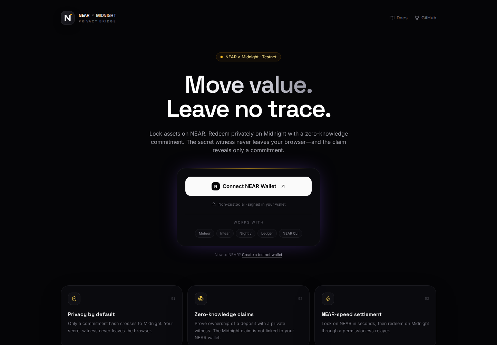
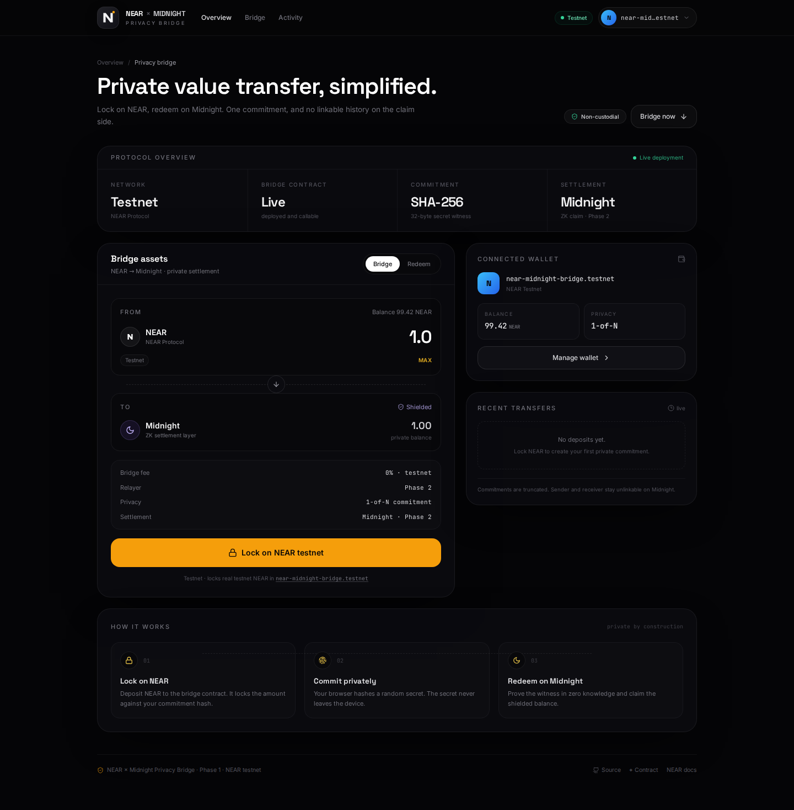

# NEAR × Midnight Privacy Bridge

**Private cross-chain settlement between NEAR and Midnight, powered by zero-knowledge commitments.**

> Built for NEAR HACKATHON 2026 · Tracks: `privacy`, `defi`, `realworld`

[Live demo](https://aryann-4.github.io/NEAR-privacy-bridge/) · [Repository](https://github.com/Aryann-4/NEAR-privacy-bridge) · [NEAR testnet contract](https://explorer.testnet.near.org/accounts/near-midnight-bridge.testnet)



---

## Status: Phase 1 live on NEAR testnet

- Real NEAR testnet wallet login, session restore, and live balance.
- `near-midnight-bridge.testnet` deployed with the `near-sdk 5` bridge contract.
- **Lock on NEAR testnet** generates the commitment locally and submits a real `deposit` transaction. The UI shows the transaction hash and an explorer link.
- Five Rust unit tests cover deposits, duplicate commitments, attached-deposit checks, secret verification, and claims.
- The Midnight Compact contract is in the repo; Preprod deployment and the ZK claim flow are Phase 2.

## The problem

Traditional bridges publish a complete trail: who moved what, to which chain, and when. That is unacceptable for payroll, business payments, private trading, or simply holding assets without being profiled.

This project breaks the link at the settlement layer. A user locks assets on NEAR against a **commitment hash** — `SHA-256(secret)`. Only the hash is published. On Midnight, the user proves knowledge of the secret in zero knowledge and claims the private balance. Observers can verify that a valid claim happened, but cannot link it back to the depositor.

## How it works

```text
        lock(amount, commitment)                claim(commitment, proof)
NEAR ───────────────────────────▶ ▼ ───────────────────────────▶ Midnight
                                  │
                        commitment = SHA-256(secret)
                        secret stays on the user's device
```

1. **Lock on NEAR** — the bridge contract stores the amount against the commitment hash. The deposit is a normal public NEAR transaction; the privacy boundary is the Midnight claim.
2. **Keep the witness private** — the browser generates a random 32-byte secret and hashes it locally. The secret never leaves the device.
3. **Redeem on Midnight** — a relayer verifies the ZK proof and releases the private balance. The same commitment cannot be spent twice.

The frontend implements the commitment lifecycle end to end: generation, real testnet lock, downloadable claim file, and local witness verification. The on-chain NEAR lock is live today; the Midnight claim is the next milestone.

## Demo



**What works today**

- Real NEAR testnet login through [`@hot-labs/near-connect`](https://github.com/hot-dao/near-selector), with session restore and disconnect.
- Live account balance fetched from NEAR RPC and refreshed after a deposit.
- Real on-chain `deposit` call with the exact attached amount, transaction hash, and explorer link.
- Client-side SHA-256 commitment generation, copy/download, and local witness verification.
- Persistent recent-activity list backed by real deposits (empty state until the first lock).
- Responsive dark UI with animated background, accessibility-minded focus states, and a NEAR-native aesthetic.

**Phase 2 / not yet live**

- Midnight Preprod deployment, Compact circuit wiring, and the ZK claim/relayer flow.
- The UI intentionally does **not** call the Phase 1 contract's `withdraw` method: that test-only path accepts the secret as a public argument, which would leak the witness. The Midnight claim will verify it without revealing it.
- No mainnet deployment. Mainnet requires audits, real NEAR for gas/storage, and Blockfrost/DUST for Midnight.

## Tech stack

| Layer | Technology |
| --- | --- |
| Frontend | React 18, Vite 5, Tailwind CSS, TypeScript |
| Wallet | NEAR Connect (`@hot-labs/near-connect`), `near-api-js` RPC |
| NEAR contract | Rust + `near-sdk 5` |
| Midnight contract | Compact |
| Privacy primitive | `commitment = SHA-256(secret)` |
| Hosting | GitHub Pages (public demo), Vercel-compatible |

## Repository layout

```text
frontend/                     React app (login, bridge, wallet, activity)
  src/WalletContext.tsx       NEAR Connect provider, session + balance
  src/lib/near-contract.ts    Contract ID, yocto conversion, deposit call
  src/lib/commitment.ts       SHA-256 commitment generation + verification
  src/components/             Landing, Dashboard, BridgeCard, AccountModal
near-contract/                near-sdk 5 lock/unlock contract + unit tests
midnight-contract/            Midnight Compact bridge contract
.github/workflows/            CI and GitHub Pages deployment
docs/                         Screenshots used in this README
```

## Run locally

Requirements: Node.js 20+ and a NEAR testnet account (for login).

```bash
git clone https://github.com/Aryann-4/NEAR-privacy-bridge.git
cd NEAR-privacy-bridge/frontend
cp .env.example .env
npm install
npm run dev
```

Open <http://localhost:5173>. Click **Connect NEAR Wallet** and choose a wallet from the NEAR Connect modal. No private keys are handled by the app.

The frontend reads `VITE_CONTRACT_ID` (defaults to `near-midnight-bridge.testnet`). Production build:

```bash
npm run build
npm run preview
```

## Contracts

### NEAR — deployed on testnet

| | |
| --- | --- |
| Account | [`near-midnight-bridge.testnet`](https://explorer.testnet.near.org/accounts/near-midnight-bridge.testnet) |
| SDK | `near-sdk 5.30.1` |
| Wasm size | 125.4 KB |
| Unit tests | 5 passing |

**Methods**

- `deposit(amount: U128, commitment: [u8; 32])` — payable; requires the attached deposit to equal `amount`, rejects the zero hash and duplicate commitments, stores the deposit, and emits a `DepositEvent`.
- `get_deposit` / `view_deposit` — return the stored deposit (amount, sender, network, claimed flag).
- `get_user_deposits` / `view_user_deposits` — total currently locked per account.
- `get_deposit_count` — number of deposits ever created.
- `withdraw(commitment, secret)` — test-only direct witness check; marks the commitment claimed and emits an `UnlockEvent`. Not used by the UI because it reveals the secret; the private claim path is Midnight's ZK circuit.

**Build and test**

```bash
cd near-contract
cargo test
cargo near build non-reproducible-wasm
```

**Deploy**

```bash
near create-account near-midnight-bridge.testnet --use-faucet
near deploy near-midnight-bridge.testnet \
  target/near/near_privacy_bridge.wasm \
  --init-function new --init-args '{}'
```

A testnet smoke test locked 1 NEAR against commitment
`110b9623d4c528c8b7cb33a02d9ec209edf38e733417d824846a95df6018bdc6`
([deposit transaction](https://explorer.testnet.near.org/transactions/75Jr4qiPSixvHaSgfYZQRAke8LQ1rVcNY75dHz4uTFLm)) and then verified and claimed it through `withdraw`.

### Midnight

`midnight-contract/contract/src/bridge.compact` stores commitments, verifies the private witness, and prevents double spends. Secrets are used as private witness data and are never persisted on-chain. Preprod deployment is Phase 2.

## Privacy model

| Public | Private |
| --- | --- |
| Commitment hash | Secret witness |
| Locked amount | Midnight claim destination |
| NEAR deposit transaction (sender, timestamp) | Link between the NEAR deposit and the Midnight recipient |
| Proof validity | User identity / history |

A NEAR deposit is public like any NEAR transaction. The commitment is a one-way hash, and the Midnight claim proves knowledge of the secret without revealing it, so the claim cannot be linked back to the depositor. The current testnet contract stores the depositor for the direct `withdraw` stub; removing that linkage from the settlement path is part of the Phase 2 relayer design.

## Hackathon tracks

- **Privacy** — the core flow hides the link between the NEAR deposit and the Midnight claim.
- **DeFi** — a reusable privacy primitive for cross-chain liquidity and payments.
- **Real world** — private payroll, vendor payments, and treasury operations.

## Roadmap

1. **Phase 1 — done:** rewrite the NEAR contract for `near-sdk 5`, deploy to testnet, wire the real `deposit` call into the UI, and show the transaction.
2. **Phase 2:** deploy the Compact contract to Midnight Preprod, connect the proof server, submit ZK claims through a relayer, and track claim status in the UI.
3. **Phase 3:** add NEP-413 message auth, encrypted claim storage, mainnet hardening, and an external audit.

## License

MIT — see [LICENSE](LICENSE).
